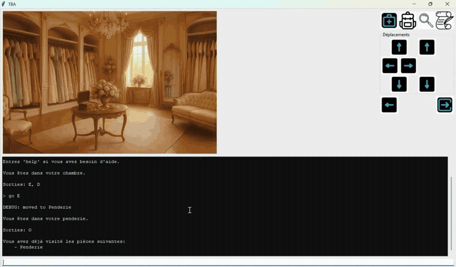
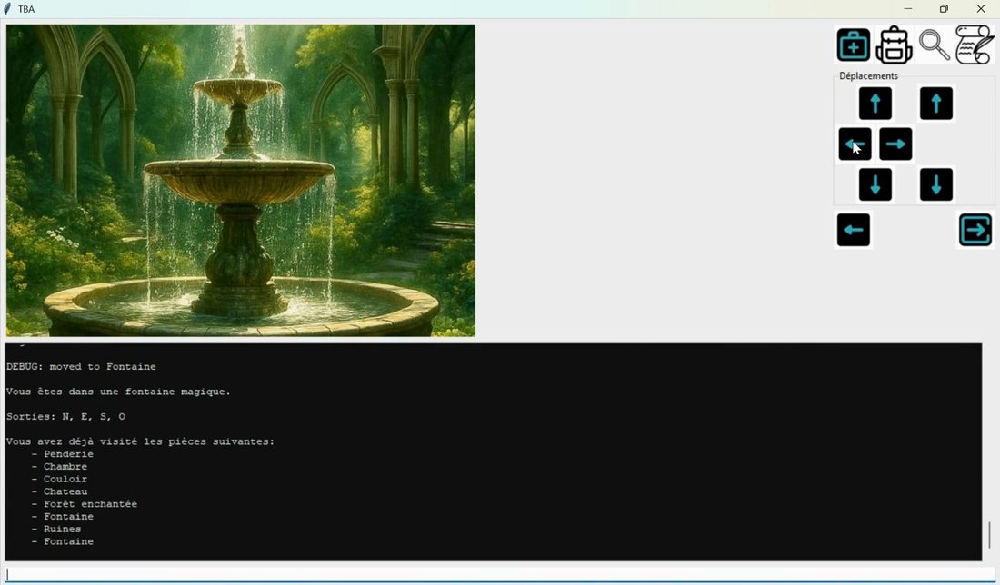
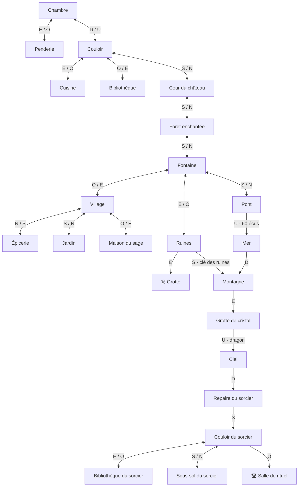
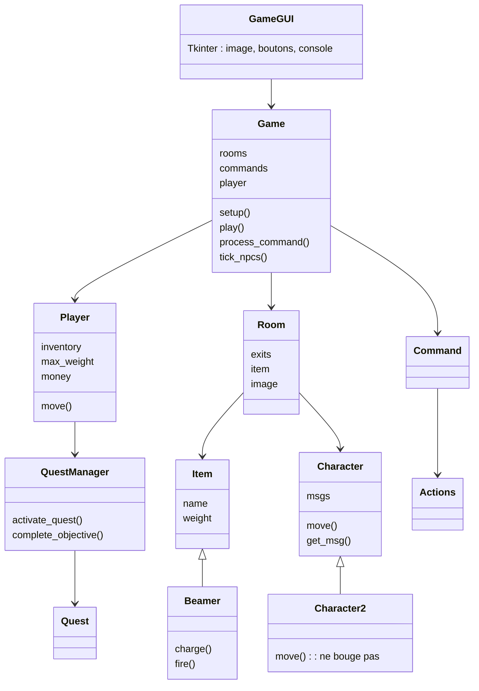

# 🧚 Hazefairy Cloud

**Jeu d'aventure en Python, avec interface graphique Tkinter et mode console.**
Projet de programmation orientée objet réalisé en binôme à l'ESIEE Paris.

*A Python adventure game with a Tkinter GUI and a console mode, built as an object-oriented programming project at ESIEE Paris.*


<p align="center">
  
</p>

---

## Le jeu

Vous incarnez une princesse dans un royaume médiéval fantastique. Un sorcier a jeté une malédiction sur le royaume : il faut traverser **24 lieux**, parler aux habitants, réunir assez d'écus pour prendre la mer, puis rejoindre le repaire du sorcier à dos de dragon pour découvrir son secret.

- **24 lieux** illustrés, reliés par 6 directions (N, E, S, O, haut, bas)
- **8 quêtes** (1 principale, 7 secondaires) avec objectifs, récompenses et monnaie (écus)
- **17 personnages**, dont certains se déplacent seuls sur la carte
- **Inventaire limité en poids** (3 kg) : il faut choisir ce qu'on emporte
- **Beamer** : un objet magique qui mémorise des lieux pour s'y téléporter
- **Retour en arrière** (`back`) grâce à une sauvegarde de l'état du jeu à chaque déplacement
- Une fin heureuse… et une façon de perdre : attention à la grotte !

<p align="center">
  
</p>

## Lancer le jeu

Aucune bibliothèque à installer : uniquement Python 3.10 ou plus récent (Tkinter est inclus dans Python sous Windows et macOS).

```bash
git clone https://github.com/berenice-bettinger/Projet-Jeu-Textuel-Python-Hazefairy-cloud-.git
cd Projet-Jeu-Textuel-Python-Hazefairy-cloud-

python game.py          # interface graphique
python game.py --cli    # mode console
```

Si Tkinter n'est pas disponible (certaines installations Linux), le jeu passe automatiquement en mode console. Pour l'installer sous Debian ou Ubuntu : `sudo apt install python3-tk`.

Une démonstration complète en vidéo est disponible dans le dépôt : [`Hazefairy-cloud.mp4`](Hazefairy-cloud.mp4).

## Commandes

Dans l'interface graphique, les boutons couvrent l'aide, l'inventaire, l'observation, les quêtes et les déplacements. Toutes les commandes peuvent aussi être tapées :

| Commande | Effet |
|---|---|
| `go <N\|E\|S\|O\|U\|D>` | Se déplacer (U = monter, D = descendre) |
| `back` · `history` | Revenir au lieu précédent · voir les lieux visités |
| `look` · `characters` | Voir les objets · les personnages présents |
| `take <objet>` · `drop <objet>` | Prendre · déposer un objet |
| `inventory` · `check` | Voir l'inventaire et le poids porté |
| `talk <personnage>` | Parler à un personnage |
| `quests` · `quest <titre>` · `activate <titre>` · `rewards` | Gérer les quêtes et voir ses récompenses |
| `charge <nom>` · `fire <nom>` · `list_beamer` | Mémoriser un lieu dans le beamer · s'y téléporter · lister les lieux mémorisés |
| `help` · `quit` | Aide · quitter |

## Carte du royaume



Les flèches simples sont des passages à sens unique. Deux chemins mènent à la montagne : le bateau (60 écus) ou la porte des ruines (clé des ruines).

## Quêtes

| Quête | Objectif | Récompense |
|---|---|---|
| **Vaincre le Sorcier** (principale) | Atteindre le repaire du sorcier et le vaincre | Victoire du royaume |
| Financer le voyage | Réunir 60 écus | Accès au bateau du pêcheur |
| Le Secret du Sorcier | Découvrir le secret de Zeph | Connaissance ancestrale |
| La Clé des Ruines | Trouver trois fragments anciens | Clé des ruines |
| Rencontrer les habitants | Parler à 5 personnages | 20 écus |
| Collecte de plantes | Récupérer une plante magique | 30 écus |
| Obtenir le beamer | Trouver le beamer magique | 30 écus |
| Souvenirs du royaume | Trouver trois souvenirs | 30 écus |

<details>
<summary>🗝️ Solution rapide (spoiler)</summary>

`go D` → `go S` → `take beamer` → `go S` → `take plante_magique` → `go S` → `go S` → `talk Pêcheur` → `go U` → `go D` → `go E` → `go U` → `go D` → `go S` → `go O` → `talk Zeph` → `talk Zeph`

</details>

## Architecture

Le code est découpé en classes, chacune avec une responsabilité claire :



| Fichier | Rôle |
|---|---|
| `game.py` | Création du monde, boucle de jeu, interface graphique Tkinter |
| `actions.py` | Une fonction par commande du joueur |
| `command.py` | Associe un mot de commande à son action (patron Commande) |
| `player.py` | Joueur : position, inventaire, poids, écus |
| `room.py` | Lieux : sorties, objets, personnages, image |
| `item.py` · `beamer.py` | Objets et beamer de téléportation |
| `character1.py` · `character2.py` | Personnages mobiles et immobiles |
| `quests.py` | Quêtes et gestionnaire de quêtes |
| `assets/` | Illustrations des lieux et icônes des boutons |

**Points techniques :**
- **Patron Commande** : chaque commande est un objet `Command` qui pointe vers une fonction de `Actions`. Ajouter une commande ne touche pas à la boucle de jeu.
- **Héritage** : `Beamer` hérite de `Item`, `Character2` hérite de `Character` et redéfinit `move()`.
- **Retour arrière** : l'état du joueur et des lieux est copié (`copy.deepcopy`) avant chaque déplacement, ce qui permet `back`.
- **Interface graphique** : la sortie console (`sys.stdout`) est redirigée vers un widget Tkinter, ce qui permet de garder le même code de jeu pour les deux modes.

## Équipe

Projet réalisé en binôme dans le cadre du cycle ingénieur de l'ESIEE Paris :

- **Bérénice Bettinger** · [LinkedIn](https://linkedin.com/in/berenice-bettinger)
- **Camille Puyrajou**
